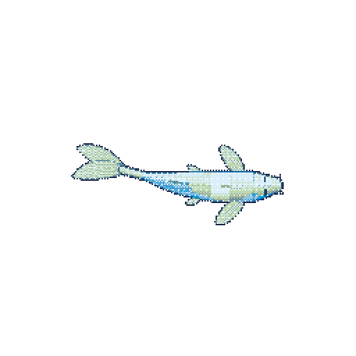
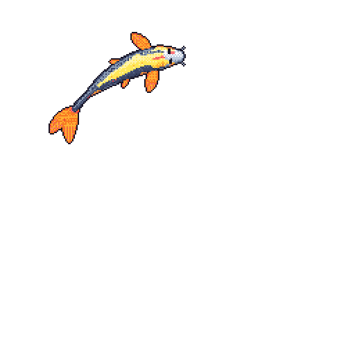
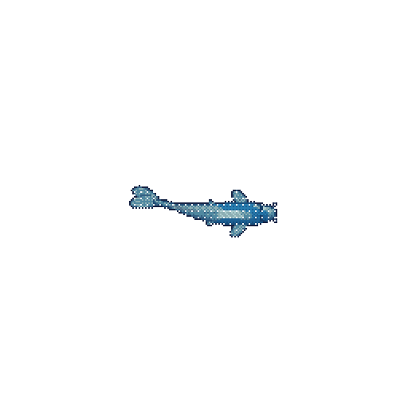

# 💫 About Me:
PhD candidate & bioinformatician in the Voolstra Lab (University of Konstanz), working on coral holobiont diversity through metabarcoding and metagenomics to understand the molecular signature of thermal resilience. 

  
  
  

## 🌐 Socials:
  

## 🔬 Projects:
- **[SymPortal](https://symportal.org)** – framework for Symbiodiniaceae ITS2 profiling (maintenance & development)
- **[CoralFuture](https://coralfuture.org)** – ED50 calculator for CBASS-derived thermal tolerance data, built on the [CBASSED50 R package](https://cran.r-project.org/package=CBASSED50)

## 💻 Tech Stack:
            

## 📊 GitHub Stats:
 
 

## 🏆 GitHub Trophies

### 🔝 Top Contributed Repo

---

<!-- Proudly created with GPRM ( https://gprm.itsvg.in ) -->
